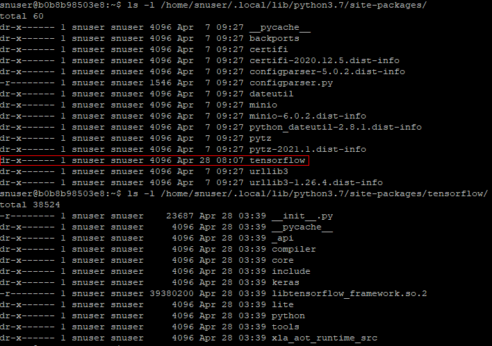

# 大包部署
目前系统支持的大包限制如下：

| 描述                                                         | 限制             |
| ------------------------------------------------------------ | ---------------- |
| 允许上传的压缩包大小                              | 50M |
| 允许上传的压缩包解压后大小     | 100M       |
| 允许上传的文件个数大小 | 30000        |
| 允许上传的文件深度     | 20       |
| 允许每个函数使用的layer个数 | 5        |

如果需要使用更大的代码包，请预先将代码包提前加载到对应语言的 runtime 镜像中默认依赖包路径。方法如下：
+ 首先参考 [安装部署](../deploy.md)流程 中的 **容器镜像打包章节** 中取得 **imageTag** ，并 pull 镜像到本地环境。
+ 准备好代码包（注意使用对应语言软件版本的依赖包），并基于当前镜像编写 Dockerfile。
  * python-runtime（python version 3.7） Dockerfile 样例：
  
    ```
    FROM ${imageTag}
  
    ENV PACKAGE_DIR=/home/snuser/.local/lib/python3.7/site-packages
    RUN mkdir -p ${PACKAGE_DIR}/tensorflow
    COPY --chown=1003:1003 tensorflow ${PACKAGE_DIR}/tensorflow
    
    USER root
    RUN find ${PACKAGE_DIR}/tensorflow -type d | xargs chmod 500 &&\
        find ${PACKAGE_DIR}/tensorflow -type f | xargs chmod 400   
    USER ${USER_NAME}
    ```
  * java-runtime （java version 1.8.0_282） ： 与 python-runtime 类似， `PACKAGE_DIR` 设置为 `/usr/lib/jvm/java-8-openjdk-amd64/jre/lib/`
  * nodejs-runtime （node version v12.18.4）： 与 python-runtime 类似， `PACKAGE_DIR` 设置为 `/node_modules`

+ 在Dockerfile所在目录执行 `docker build -t ${imageTag} .` ，基于当前镜像，制作新的镜像，覆盖原有镜像。
+ 执行 `docker run -ti --entrypoint /bin/bash ${imageTag}` ，验证效果如下：
  