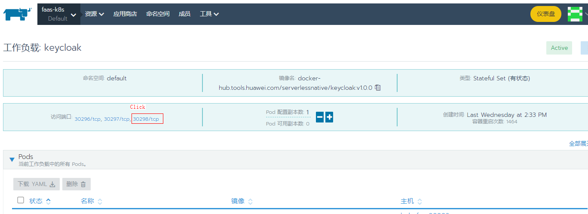
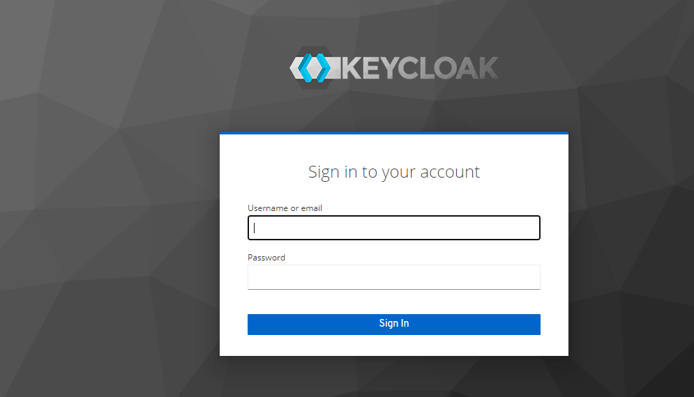
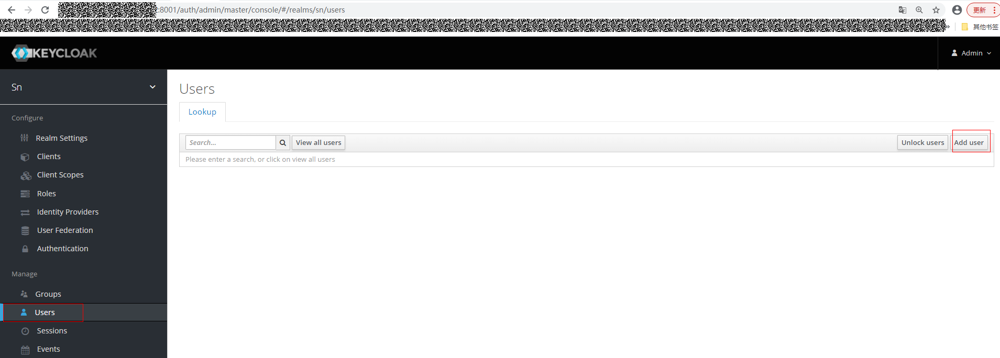
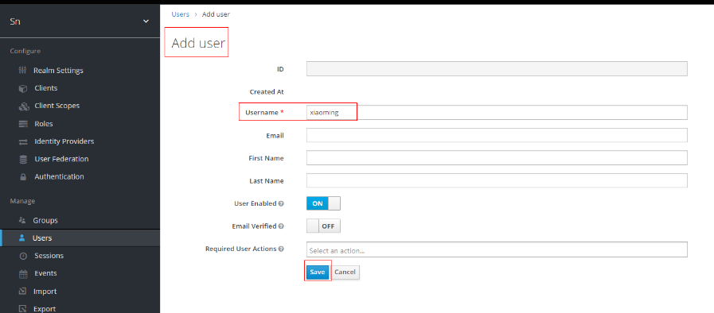
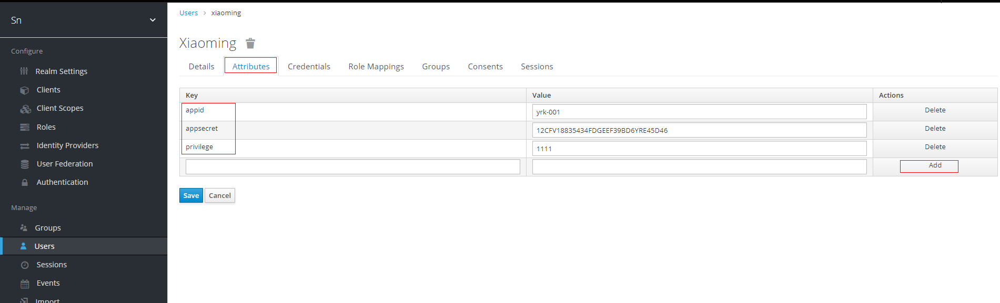
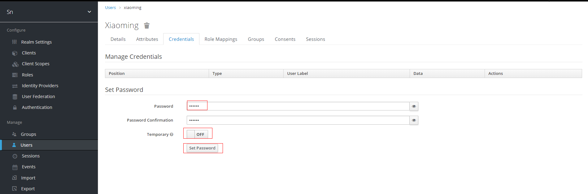
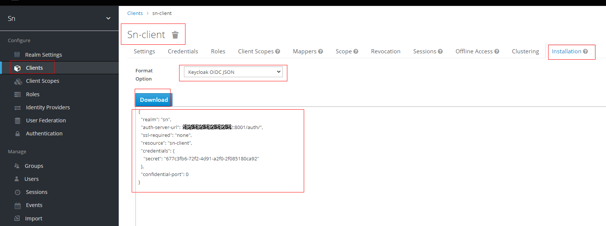
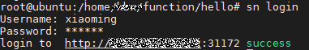

# keycloak 创建用户

keycloak 是开源软件，提供用户管理功能，如果开发者需要为用户提供租户管理时，可参考本节指导。 详细的使用说明以官网 [Getting Started Guide](https://www.keycloak.org/docs/latest/getting_started/#creating-a-user) 为准。

## 登录 keyclock

从 rancher 的工作负载的 **keycloak** 点击**30298**登录。



如果网页上面显示 **WE’AR SORRY， HTTPS required**, 请再次执行脚本
 
**bash process.sh -o install -m keycloak**

或者进入 keycloak 容器里面执行一下命令：

localip 为 keycloak 的 pod_ip, keycloak_password 为 keycloak的登录密码

```
    cd /opt/jboss/keycloak/bin
    ./kcadm.sh config credentials --server http://"${localip}:8080"/auth --realm master --user admin --password ${keycloak_password}
    ./kcadm.sh update realms/master -s sslRequired=NONE
```

使用 **process.sh** 部署默认的用户名: **admin** 和密码:  **admin**



登录后的界面：



## 定义用户名

以条件 **xiaoming** 用户为例。



## 定义用户属性

点击标签页 **Attributes** 定义用户属性，**Key** 的必填项如下 。

| 参数          | 描述                                                         | 约束             |
| ------------- | ------------------------------------------------------------ | ---------------- |
| **appid**     | 用户接口鉴权 ID ，例如：yrk-001                              | 字段长度（1, 16] |
| **appsecret** | 用户接口鉴权秘钥，例如：12CFV18835434FDGEEF39BD6YRE45D46     | 字段长度32       |
| **privilege** | 用户对函数的操作权限：从左到右依次为创建、更新、删除、查询，有权限置1，无权限置其它值， 例如：1111，说明该用户具备创建、更新、删除、查询的权限 | 字段长度4        |

>  因为 token 位于 http 请求头中，且 token 的长度约束为 3kb,  所以不建议创建用户的时候在用户的 token 中添加过多字段，以免 CLI 用户登录失败。



## 定义用户密码

点击标签页 **credentials** ， **temporary** 需设置为 **off** 。



## 查看 keycloak.json 文件

在左侧栏选择 **Clients** ， 在 **Lookup** 中选择 sn-client ，点击进入页面后选择标签页 **installation** ，在 **Format Option** 下拉框中选择 **keycloak OIDC JSON** 可以查看 keycloak.json 文件。

> 若是外置安装 keycloak ，则 Iam-adaptor 的 configmap 中部分字段需用到此文件。




## CLI登录



> keycloak 中一个用户可以属于多个 group，但是 FunctionCore 中一个用户只能属于一个租户，所以会随机选一个 groupID 作为用户的租户 ID 。 当用户不属于任何一个 group 的时候， 用户 ID 即为租户 ID 。
