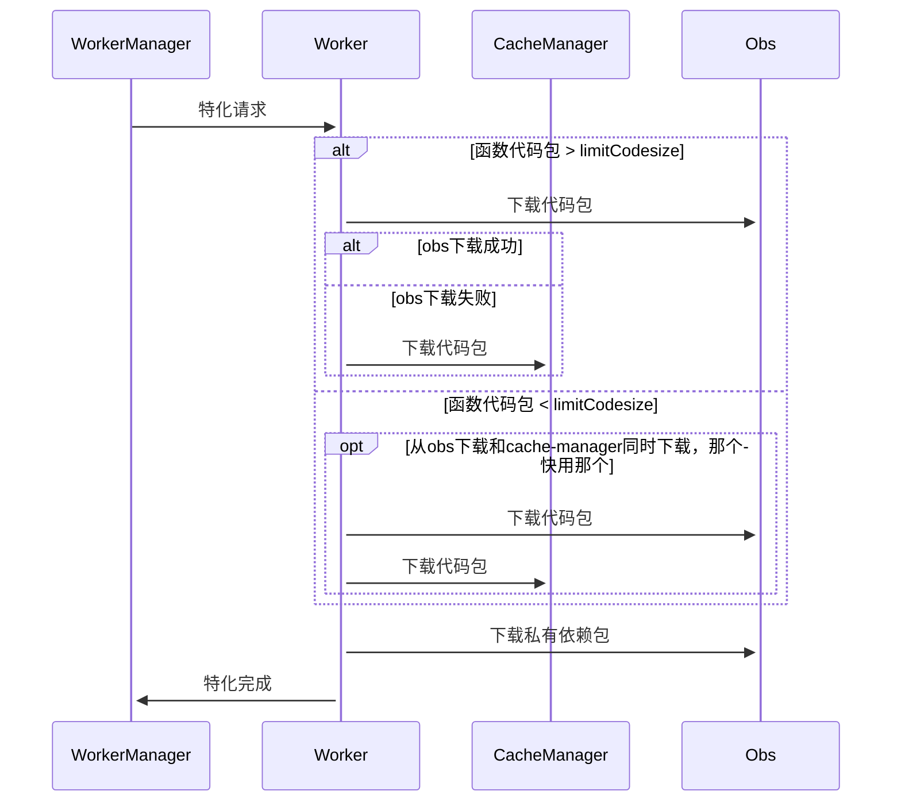

[TOC]

# 【服务依赖】OBS故障不影响函数正常冷启动和弹性

## 1. 需求场景分析

### 1.1 特性需求来源与价值概述

【服务依赖】OBS故障不影响函数正常冷启动和弹性，防止obs故障了，影响现有函数的正常冷启动和弹性，让函数下载代码时候可以从cache-manager下载。

### 1.2特性场景分析

本次设计修改的组件有worker和cache-manager。

### 2.1总体方案

当前cache-manager已经支持evs，本次需求需要完成以下功能：

1. cce上创建pvc，由于1个pvc只能挂到一个pod上，cache-manager为两个实例，需要购买两个pvc，挂载到cache-manager两个不同的实例上。升级版本时，需要先购买在cce上购买pvc，同时将购买好的pvc，同步购买好的pvc名称，添加到到部署文件中的pvcname字段中。
2. cache-manager中支持私有依赖包的缓存，同时worker支持私有依赖包从cache-manager下载，现在场qq景中，私有依赖包不在cache-manager中落盘缓存。
3. 由于cache-manager中每次会对整个下载下来的代码包进行加密，所以整个下载过程中，占用内存较大。同时当前cache-manager中lru占用一部分内存，同时测试发现lru在回收时有问题，当前代码包最大支持300M，cache-manager内存为4G，增加内存限流，防止在cache-manager监听到元数据下载代码包的同时，worker从cache-manager请求，导致cache-manager发生oom。
4. worker对于layer的下载不会走cache-manager，只会从obs下载，由于layer不同于代码包，元数据中没有codesize，当前修改发现走cache-manegr下载时，worker会oom，解决此问题。

### 2.2模块详细设计

当前的代码包和依赖包下载：

针对以上总体方案中提出

1. cce上购买pvc，在cache-manager的deployment中修改配置指定挂载的pvc。
2. 当前代码包和依赖包的大小最大为300M，增加cache-manager中对于依赖包的下载和缓存。
3. 当前cache-manager中内存占用主要在lru和监听到元etcd后下载代码包，并且对代码包落盘时，需要对整个代码包加密，当前开放出大包也缓存在cache-manager中时，测试过程中发现会触发cache-manager发生oom。
   cache-manager中内存分成多个部分：

   <1> lru中常驻内存

   <2> 监听到etcd时，下载代码并且加密数据时候的内存占用。

   <3> worker请求cache-manager时，lru中没有，需要从磁盘中加载，此时磁盘加载过程中加解密文件的内存占用。

   所以针对此情况，增加内存限流，设置高低水位。
   worker请求cache-manager时，由于layer中无法获取代码包的大小，我们无法知道当前请求占用内存多少，代码包最大支持300M，这里设置高低水位主要是用于防止cache-manager组件在下载大包时候出现oom。
   当低水位时，任何worker过来的请求都可以通过，达到低水位且没有到高水位时，按照原来的流程，允许100k以下的代码包请求通过。达到高水位时候，任何大小的代码包请求都拒绝。
   当前cache-manager中监听到元数据就会使用协程池中协程去下载代码包，并且加密，判断是否增加到lru中，落盘。此部分内存的消耗无法根据请求来判定，所以这一部分的内存需要先排除在外，在计算高低水位，待转测时，验证过后给出确定好高低水位，来防止oom。高低水位可配置，热加载。
4. worker中当前对于私有依赖包只走obs下载，不会走cache-manager下载，修改此部分逻辑，obs下载失败的情况下，走cache-manager下载。

### 2.3 约束

#### 2.3.1上下游依赖需求

#### 2.3.2其他约束

## 3. 可信软件

### 3.1安全性（Security） 

不涉及

*【系统对恶意威胁的防护能力。可能的威胁包括但不限于未授权访问、使用、泄露、破坏、修改、毁灭；防护目标是保持信息的机密性、完整性和可用性】* 

### 3.2韧性（Resilience）

不涉及

*【系统受攻击时保持在有定义的运行状态（包括降级）、遭遇攻击时快速恢复核心系统、受攻击后在业务需要的时间窗内恢复到有效运行态】* 

### 3.3隐私性（Privacy） 

*【系统具备能力能使客户（含组织和个人）能够就收集、使用、保有、披露和处置个人信息履行其权利和义务】*
不涉及隐私

### 3.4可靠性（Reliability）

*【在给定的条件、给定的时间区间能无失效地执行要求的能力】*

### 3.5可用性（Availability）

不涉及

*【系统可操作和可访问的程度，或能实现其指定系统功能的概率】*

### 3.6安全（Safety）

不涉及

*【系统失效导致的危害不存在不可接受的风险，不会伤害自然人生命或危及自然人健康，不管是直接还是通过损害环境或财产间接造成的* 】

### 3.7可维护性

不涉及

*【系统的可修复(恢复)性和可改进性的难易程度】*

### 3.8可测试性

*【代码本地LLT易测试、针对外部接口测试、测试用例具有稳定性】*

### 3.9性能

不涉及

*【评估需求本身的性能影响、对其他流程的性能影响】*

### 3.10资源

不涉及

*【评估需求对资源的占用，例如go协程，文件句柄、内存、cpu】*

### 3.11资料

不涉及

*【客户可感知的需求，需要输出相应资料】*

### 3.12升级兼容性

不涉及

*【是否兼容之前的版本、是否支持单组件独立升级】*

## 4. 用例

| **序号** | **用例名** | 用例类型 | **测试步骤**                                                 | **预期结果**                  |
| -------- | ---------- | -------- | ------------------------------------------------------------ | ----------------------------- |
| 1        | 下载依赖包 | ST       | 查看cache-manager是否有缓存私有依赖包                        | cache-manager缓存了私有依赖包 |
| 2        | 内存限流   | ST       | 进入容器查看内存情况，达到低水位的时候，小包下载ok，高水位的时候，请求拒绝 | 内存限流成功                  |
