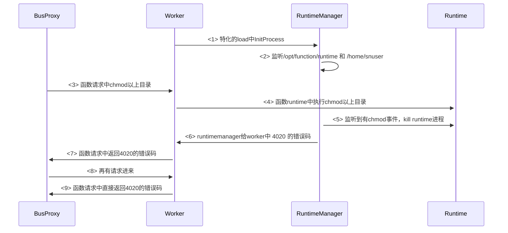

[TOC]

# runtime容器CAP_SYS_ADMIN移除后补充磁盘防爆机制

## 1. 需求场景分析

### 1.1 特性需求来源与价值概述

安全场景需求

### 1.2特性场景分析

移除CAP_SYS_ADMIN后，runtime-manager无法再通过remount机制将runtime容器目录修改为只读，用户函数可以修改部分snuser目录权限并向其中写入大量数据，所以针对此情况对 /opt/function/runtime 和 /home/snuser 目录进行监控达到防爆目的。

### 2.1总体方案

### 2.2模块详细设计

在runtime-manager中通过fsnotify监听/opt/function/runtime 和 /home/snuser 这两个目录，当前此目录是只读权限，如果需要写入文件则需要chmod，监听发现此目录下chmod事件，runtime-manager则会杀掉runtime进程，并返回给worker一个错误码这个暂定为4020，当发现出现此错误码时，有请求进来，立马返回此错误码，不执行函数请求。

1>  特化过程中，runtime-manager接收到请求，监听/opt/function/runtime 和 /home/snuser 目录

2>  由于当前整个目录已经是只读的，要想写入的话，函数中要先执行chmod，runtime-manager监听到有chmod，直接kill runtime进程。

3>  runtime-manager 杀掉runtime进程，对错误码进行override成4020错误码。

4>  worker检测到进程退出，拿到这错误码返回，并且记录当前标志。

5>  有请求再进来，如果发现之前该标志，直接返回4020错误码，不在执行用户代码。

新增用户错误码说明：

错误码 4020 ， 错误信息：用户操作/home/snuser 和 /opt/function/runtime 目录不允许。 

### 2.3 约束

以下场景可能出现调用成功，与se对齐后，此情况可以接受：

函数代码中直接chmod，后返回，由于监听处理到kill runtime也存在一定的时间，所以会出现调用成功，但是之后的调用就会返回4020错误码。

#### 2.3.1上下游依赖需求

#### 2.3.2其他约束

## 3. 可信软件

### 3.1安全性（Security） 

本需求就是基于之前的安全提出对 runtime容器中 /home/snuser 目录 和 /opt/function/runtime目录进行监控。

*【系统对恶意威胁的防护能力。可能的威胁包括但不限于未授权访问、使用、泄露、破坏、修改、毁灭；防护目标是保持信息的机密性、完整性和可用性】* 

### 3.2韧性（Resilience）

不涉及

*【系统受攻击时保持在有定义的运行状态（包括降级）、遭遇攻击时快速恢复核心系统、受攻击后在业务需要的时间窗内恢复到有效运行态】* 

### 3.3隐私性（Privacy） 

*【系统具备能力能使客户（含组织和个人）能够就收集、使用、保有、披露和处置个人信息履行其权利和义务】*
不涉及隐私

### 3.4可靠性（Reliability）

 可靠性相关与之前计费流程一样，所以没有涉及新增，与之前的连接functiontask失败、连接redis失败等可靠性场景一致，原有可靠性场景已经覆盖，未新增上报的逻辑。

*【在给定的条件、给定的时间区间能无失效地执行要求的能力】*

### 3.5可用性（Availability）

不涉及

*【系统可操作和可访问的程度，或能实现其指定系统功能的概率】*

### 3.6安全（Safety）

**这里加一下**

*【系统失效导致的危害不存在不可接受的风险，不会伤害自然人生命或危及自然人健康，不管是直接还是通过损害环境或财产间接造成的* 】

### 3.7可维护性

不涉及

*【系统的可修复(恢复)性和可改进性的难易程度】*

### 3.8可测试性

*【代码本地LLT易测试、针对外部接口测试、测试用例具有稳定性】*

### 3.9性能

不涉及

*【评估需求本身的性能影响、对其他流程的性能影响】*

### 3.10资源

不涉及

*【评估需求对资源的占用，例如go协程，文件句柄、内存、cpu】*

### 3.11资料

不涉及

*【客户可感知的需求，需要输出相应资料】*

### 3.12升级兼容性

本次是新增流程兼容以前，可以直接升级。

*【是否兼容之前的版本、是否支持单组件独立升级】*

## 4. 用例

| **序号** | **用例名**                                 | 用例类型 | **测试步骤** | **预期结果**                         |
| -------- | ------------------------------------------ | -------- | ------------ | ------------------------------------ |
| 1        | 函数中执行chmod /opt/function/runtime/     | ST       | 调用函数     | 首次可能成功，之后调用返回4220错误码 |
| 2        | 函数init中执行chmod /opt/function/runtime/ | ST       | 调用函数     | 首次可能成功，之后调用返回4220错误码 |

