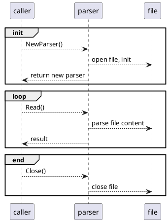

[TOC]

# 提升用户函数实例CPU利用率采集精准度

## 1. 需求场景分析

### 1.1 特性需求来源与价值概述

在降成本专项中，需要根据用户函数的CPU使用情况，做用户函数画像。这一功能依赖函数实例的CPU利用率采集。而之前已经做的CPU利用率采集，精度只能到1s。结合上海一的函数实际执行时延，函数执行在1s以上的请求只占了总请求数量的2%，意义有限。因此需要在原有基础上，提高CPU利用率的采集精度。

### 1.2特性场景分析

当前的CPU采集频率为写死的1s，并且是由runtime-manager采集之后，通过TCP连接上报给worker。

通过修改代码中的采集频率，得到一组 采集频率对CPU消耗 的基线数据。

| 采集频率 | runtime-manager 空闲CPU使用 | worker空闲CPU使用 |
| ---- | ----------------------- | ------------- |
| 1s   | 50m                     | 3m            |
| 10ms | 70m                     | 11m           |
| 5ms  | 85m                     | 16m           |
| 2ms  | 125m                    | 30m           |

可以看到，即便是1s的采集频率，当前runtime-manager的空闲CPU使用就已经比较高了，若要进一步提高采集频率，需要做一定的性能优化。

## 2. 特性/功能实现原理

### 2.1总体方案

原先识别出两块优化点：

1. 采集火焰图，针对性的对代码进行优化

2. 将runtime的cgroup挂载进worker容器，采集功能移动到worker中，砍掉runtime-manager上报worker的流程

初步验证，第一点的确存在较大的优化空间，而第二点在黄区环境存在挂载冲突，会导致整个环境挂掉不可用，暂无解决方案，因此这块不做处理，只针对第一点做代码上的性能优化。

优化完成后，默认采集频率由1s提升到2ms，可通过环境变量进行配置，不在代码中写死。

### 2.2模块详细设计

#### 2.2.1 cgroup解析优化

当前针对容器的CPU、Memory指标采集，都是通过定时解析Cgroup文件来实现的。但是具体到代码实现上，当前存在比较大的性能问题：

- 每次解析时，都会先打开文件句柄，读取文件后再关闭文件句柄；随着采集频率的提高，这部分Syscall的开销会非常大

- 当前涉及文件解析的部分，使用了较多string操作，相比[]byte效率偏低

- runtime-manager没有配置正确的GOMAXPROCS参数，容易造成CPU空转

由于cgroup解析在很多组件中都有使用，考虑设计一个公共的解析模块，内部封装好优化后的代码实现，并预置了一些常用的Cgroup解析器。

##### 2.2.1.1模块实现



##### 2.2.1.2模块对外接口定义

模块预制了一些常用的解析器

```go
// 解析CGroup /sys/fs/cgroup/cpuacct/cpuacct.usage下的CPU使用情况
func NewCGroupCPUParser() (*Parser, error)
// 解析CGroup /sys/fs/cgroup/memory/memory.stat下的内存使用
func NewCGroupMemoryParser() (*Parser, error)
//解析/proc/{pid}/statm 进程pid对应的内存使用
func NewProcMemoryParser(pid string) (*Parser, error)
// 解析 /proc/stat 系统整体的CPU使用
func NewSystemCPUParser() (*Parser, error)
```

Parser解析器只有Read和Close方法，用于返回文件的解析结果以及关闭文件句柄

```go
func (p *Parser) Read() (uint64, error)
func (p *Parser) Close() error
```

### 2.3 约束

#### 2.3.1上下游依赖需求

#### 2.3.2其他约束

## 3. 可信软件

### 3.1安全性（Security）

不涉及

### 3.2韧性（Resilience）

不涉及

### 3.3隐私性（Privacy）

不涉及

### 3.4可靠性（Reliability）

不涉及

### 3.5可用性（Availability）

不涉及

### 3.6安全（Safety）

不涉及

### 3.7可维护性

不涉及

### 3.8可测试性

不涉及

### 3.9性能

在原有基础上优化，提升采集性能

### 3.10资源

在原有基础上进行优化，降低资源占用

### 3.11资料

不涉及

### 3.12升级兼容性

不涉及

## 4. 用例

| **序号** | **用例名**       | 用例类型 | **测试步骤**                                       | **预期结果**                                                       |
| ------ | ------------- | ---- | ---------------------------------------------- | -------------------------------------------------------------- |
| 1      | CPU型，执行时延2ms+ | ST   | 编写函数，内部逻辑为大量数值计算，整体时延控制在2ms以上，观察执行后采集的CPU使用情况  | 300-128规格的函数，可采集到结果且均接近0.3U；                                   |
| 2      | IO型，执行时延2ms+  | ST   | 编写函数，内部逻辑为简单的IO操作，整体时延控制在2ms以上，观察执行后采集的CPU使用情况 | 300-128规格，可采集到结果；在时延低的情况下，平均CPU使用率有较大波动，随着调用时延变长，CPU使用率变低且波动变小 |
