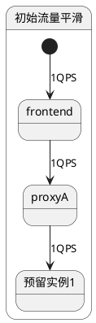
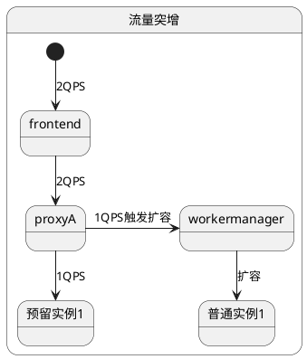
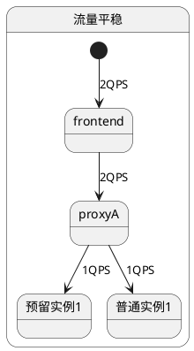
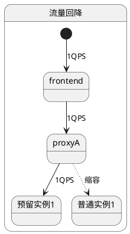
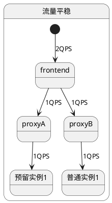
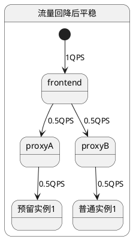
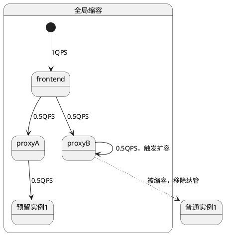
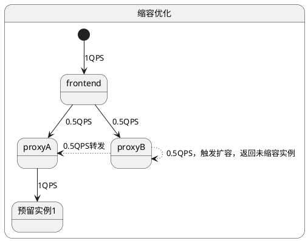

[TOC]

# 函数弹性缩容算法精确，缩容多余实例

关联AR:
+ AR.SR.IREQ02749864.006.001: 函数弹性缩容算法精确，缩容多余实例

## Story 整体设计

### 功能描述
弹性缩容精确，在流量存在较大波动的情况下，可以更精确的缩容多余实例，降低用户成本。

### 场景分析
*描述用户使用场景，尽量使用用例图、交互图等描述*

### 方案详细设计

#### 现状分析
当前的弹性缩容算法，是每个proxy根据**（当前请求量/worker处理能力）向上取整**来计算需要保留的实例数，在流量持续平滑的情况下，可以做到精准。

在单个proxy管理的理想情况下，即便存在流量的突增和下降，也能保持全局合理的实例个数：

但是如果新扩出的普通实例在其他节点上，在流量下降之后，可能会出现无法缩容的情况：

目前虽然存在workermanager全局缩容功能来兜底，但是仍存在以下问题：

1. 全局缩容需要20分钟的时间窗，周期较长

2. 缩容时可能会存在以下场景：proxy已经将缩容实例从调度队列里移除了，而frontend的路由表还没更新，可能仍会触发扩容出新的实例。

   （这个场景原本是靠反压兜底，但是为了避免反压次数过多，目前反压限制为最多一次，可能会出现这种反复缩扩实例的情况）

#### 方案设计
目前仅有workermanager能看到全局的资源视图，需要依赖workermanager进行精准缩容。

- 目前全局缩容时间为20分钟，时间较长，需要调整为一个更为合理的较小值（暂定5分钟，可根据参数配置，待实测效果）。

针对缩容后又触发扩容的情况，workermanager需要在cache中维护一个缩容视图：

- 标记每次全局缩容时，有哪些节点上的实例被缩容了。

当workermanager收到proxy的扩容请求时，会增加一个检查步骤（此步骤默认开启，可由配置项关闭）：

+ 若需要扩容的函数刚刚（需要确定一个时间，例如5秒内，可根据参数配置，待实测效果）在发送扩容请求的proxy节点上被全局缩容
+ - 若其他节点上已经没有任何实例了，则走正常扩容流程
- 否则返回一个其他节点上的实例

#### 开源软件选型
无

#### 设计模块和其他模块的交互关系，以及同其它模块的依赖关系
*描述本次设计模块和其他模块的交互关系，以及同其它模块的依赖关系*

### 对外接口
无

### 约束

## 可信软件

#### 安全性 Security
*系统对恶意威胁的防护能力。可能的威胁包括但不限于未授权访问、使用、泄露、破坏、修改、毁灭；防护目标是保持信息的机密性、完整性和可用性*

#### 韧性 Resilience
*系统受攻击时保持在有定义的运行状态（包括降级）、遭遇攻击时快速恢复核心系统、受攻击后在业务需要的时间窗内恢复到有效运行态*

#### 隐私性 Privacy
*系统具备能力能使客户（含组织和个人）能够就收集、使用、保有、披露和处置个人信息履行其权利和义务*

#### 可靠性 Reliability
*在给定的条件、给定的时间区间能无失效地执行要求的能力*

#### 可用性 Availability
*处于按要求执行状态的能力*

#### 安全 Safety
*系统失效导致的危害不存在不可接受的风险，不会伤害自然人生命或危及自然人健康，不管是直接还是通过损害环境或财产间接造成的*

## LLT 用例
用例一：

1. 配置函数预留实例个数1，并发1
2. 多并发调用，扩容出多个普通实例。
4. 保持1并发调用，观察扩容出来的普通实例是否缩容，且缩容后不会特化新的普通实例。重点观察扩容实例与预留实例在不同节点上的情况。

