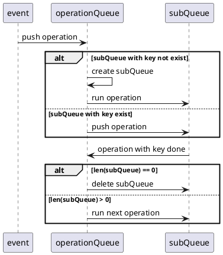

[TOC]

# workermanager 事件处理优化

## 1. 需求场景分析

### 1.1 特性需求来源与价值概述

该需求为内部逻辑的重构优化，来源为workermanager历史编码过程中发现的时序问题。

### 1.2特性场景分析

workermanager当前队列实现主要存在一个时序问题：

以pod事件为例，删除一个pod会产生多个update事件和一个delete事件，多个协程并发消费事件的时候，就可能会出现先处理了delete事件后处理update事件的情况，导致缓存内部实例数计数不准确。原先是通过事件处理的时候增加一系列判断条件来解决的。

## 2. 特性/功能实现原理

### 2.1总体方案

增加一个两级的调度队列，一级队列根据事件的key分发给二级队列，保证相同的key分发给同一个二级队列，二级队列串行处理这些事件；各二级队列之间并行处理。

### 2.2模块详细设计

#### 2.2.1 OperationQueue子模块设计

##### 2.2.1.1模块实现



##### 2.2.1.2模块对外接口定义

```go
type Operation struct {
	Key string
	Run func()
}

type OperationQueue interface {
	Push(Operation)
}
```

### 

### 2.3 约束

#### 2.3.1上下游依赖需求

#### 2.3.2其他约束

## 3. 可信软件

### 3.1安全性（Security）

*【系统对恶意威胁的防护能力。可能的威胁包括但不限于未授权访问、使用、泄露、破坏、修改、毁灭；防护目标是保持信息的机密性、完整性和可用性】* 

内部队列重构优化，不涉及

### 3.2韧性（Resilience）

*【系统受攻击时保持在有定义的运行状态（包括降级）、遭遇攻击时快速恢复核心系统、受攻击后在业务需要的时间窗内恢复到有效运行态】* 

内部队列重构优化，不涉及

### 3.3隐私性（Privacy）

*【系统具备能力能使客户（含组织和个人）能够就收集、使用、保有、披露和处置个人信息履行其权利和义务】*
内部队列重构优化，不涉及

### 3.4可靠性（Reliability）

*【在给定的条件、给定的时间区间能无失效地执行要求的能力】*

内部队列重构优化，不涉及

### 3.5可用性（Availability）

*【系统可操作和可访问的程度，或能实现其指定系统功能的概率】*

内部队列重构优化，不涉及

### 3.6安全（Safety）

*【系统失效导致的危害不存在不可接受的风险，不会伤害自然人生命或危及自然人健康，不管是直接还是通过损害环境或财产间接造成的* 】

内部队列重构优化，不涉及

### 3.7可维护性

*【系统的可修复(恢复)性和可改进性的难易程度】*

内部队列重构优化，不涉及

### 3.8可测试性

*【代码本地LLT易测试、针对外部接口测试、测试用例具有稳定性】*

内部队列重构优化，可用LLT覆盖

### 3.9性能

*【评估需求本身的性能影响、对其他流程的性能影响】*

相比原先流程，增加了二级队列调度，单次事件处理性能会略有下降（本地评估单次开销约1-3微妙），但是同时，由于队列可以承载更高的并发量，在事件较多的情况下，整体性能和之前基本一致。

目前事件处理都是几十微妙级到毫秒级，从全局视角看感知不到性能差异。

### 3.10资源

*【评估需求对资源的占用，例如go协程，文件句柄、内存、cpu】*

由之前固定200协程池在后台永久执行处理，改为了2个固定协程+协程池的形式；由于go本身协程比较轻量，整体资源占用与之前基本一致。

### 3.11资料

*【客户可感知的需求，需要输出相应资料】*

内部队列重构优化，不涉及

### 3.12升级兼容性

*【是否兼容之前的版本、是否支持单组件独立升级】*

内部队列重构优化，不涉及

## 4. 用例

| **序号** | **用例名**               | 用例类型 | **测试步骤**                                                               | **预期结果**                                     |
| ------ | --------------------- | ---- | ---------------------------------------------------------------------- | -------------------------------------------- |
| 1      | TestNewOperationQueue | LLT  | 1。构造大量相同key的事件，每个事件处理都会sleep一段时间，塞入队列后，再构造一些不同key的事件，塞入队列   2。观察事件处理顺序 | 相同key的事件在排队串行处理；与此同时，后入队的不同key的事件，不受影响，在并行处理 |